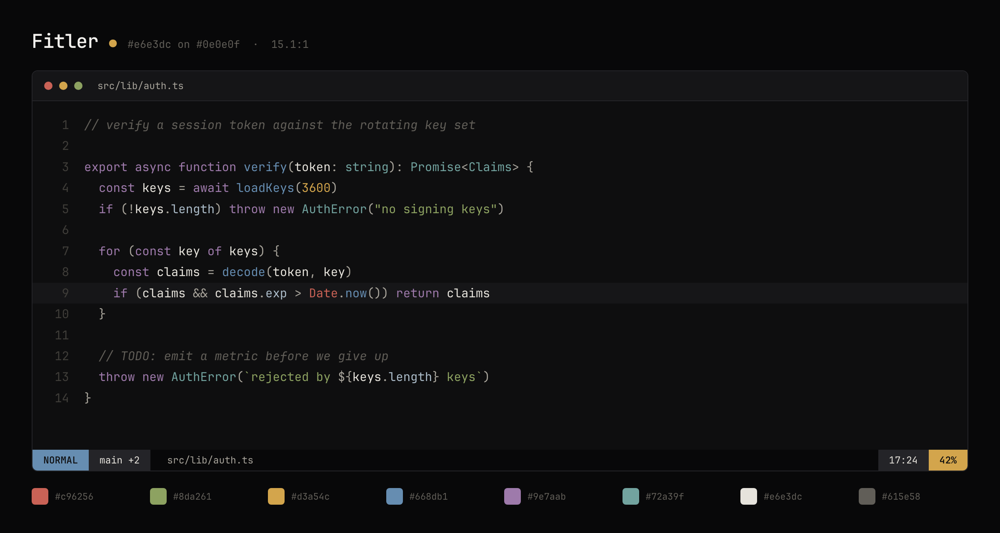

<h1 align="center">Fitler</h1>

<p align="center">
  Named for Fitler Square. Paper-white text on warm charcoal; every hue desaturated until it stops shouting.<br>
  <sub>One palette. Every tool. Generated, not copy-pasted.</sub>
</p>

<p align="center">
  
</p>

## Install

Everything is generated from a single file, so pick a tool and take the config —
or clone and symlink the lot.

<details>
<summary><b>Ghostty</b></summary>

```sh
mkdir -p ~/.config/ghostty/themes
curl -o ~/.config/ghostty/themes/fitler \
  https://raw.githubusercontent.com/johntaormina/fitlertheme/main/out/ghostty/fitler
```

Then in `~/.config/ghostty/config`:

```
theme = fitler
```
</details>

<details>
<summary><b>Neovim</b></summary>

Not a plugin — a single colorscheme file, so there is nothing to manage.

```sh
mkdir -p ~/.config/nvim/colors
curl -o ~/.config/nvim/colors/fitler.lua \
  https://raw.githubusercontent.com/johntaormina/fitlertheme/main/out/nvim/colors/fitler.lua
```

```lua
vim.cmd.colorscheme("fitler")
```

LazyVim:

```lua
return {
  { "LazyVim/LazyVim", opts = { colorscheme = "fitler" } },
}
```

Transparent background — set before the colorscheme loads:

```lua
vim.g.fitler_transparent = true
```
</details>

<details>
<summary><b>lualine</b></summary>

Drop `out/nvim/lua/lualine/themes/fitler.lua` anywhere on your runtime path, then:

```lua
require("lualine").setup({ options = { theme = "fitler" } })
```
</details>

<details>
<summary><b>VS Code</b></summary>

Not on the Marketplace. Symlink or copy `out/vscode/` into your extensions folder:

```sh
ln -s "$PWD/out/vscode" ~/.vscode/extensions/fitler-theme
```

Restart, then <kbd>Cmd</kbd>+<kbd>Shift</kbd>+<kbd>P</kbd> &rarr; Color Theme &rarr; Fitler.
</details>

<details>
<summary><b>tmux</b></summary>

```sh
curl -o ~/.config/tmux/fitler.conf \
  https://raw.githubusercontent.com/johntaormina/fitlertheme/main/out/tmux/fitler.conf
```

In `~/.tmux.conf`:

```
source-file ~/.config/tmux/fitler.conf
```
</details>

<details>
<summary><b>zsh (oh-my-zsh)</b></summary>

```sh
curl -o ~/.oh-my-zsh/custom/themes/fitler.zsh-theme \
  https://raw.githubusercontent.com/johntaormina/fitlertheme/main/out/zsh/fitler.zsh-theme
```

In `~/.zshrc`: `ZSH_THEME="fitler"`

Uses colored text rather than powerline separators, so it renders correctly in
any monospace font. No Nerd Font required.
</details>

<details>
<summary><b>herdr</b></summary>

```sh
mkdir -p ~/.config/herdr
curl -o ~/.config/herdr/fitler.toml \
  https://raw.githubusercontent.com/johntaormina/fitlertheme/main/out/herdr/fitler.toml
```

herdr's `config.toml` holds more than theme, so this isn't dropped in as its
own file — merge the `[theme]` and `[theme.custom]` blocks into your existing
`~/.config/herdr/config.toml`.
</details>

<details>
<summary><b>Windows Terminal</b></summary>

`settings.json` holds more than schemes, so this isn't dropped in as its own
file either — copy the object from
[`out/windows-terminal/fitler.json`](out/windows-terminal/fitler.json) into
the `"schemes"` array in `settings.json` (<kbd>Ctrl</kbd>+<kbd>,</kbd> &rarr;
open JSON file), then set `"colorScheme": "Fitler"` on a profile.
</details>

<details>
<summary><b>Warp</b></summary>

```sh
mkdir -p ~/.warp/themes
curl -o ~/.warp/themes/fitler.yaml \
  https://raw.githubusercontent.com/johntaormina/fitlertheme/main/out/warp/fitler.yaml
```

Then pick it under Settings &rarr; Appearance &rarr; Themes.
</details>

<details>
<summary><b>All of it, kept in sync</b></summary>

```sh
git clone https://github.com/johntaormina/fitlertheme
cd fitler && ./install.sh
```

Symlinks every target into place. Edit `palette.json`, run `python3 build.py`,
and every tool updates at once — no reinstall.

Absolute symlinks, so re-run `./install.sh` if you ever move the folder.
</details>

## Palette

| key | hex | role |
| --- | --- | --- |
| `bg` | `#0e0e0f` | editor background |
| `bgAlt` | `#080809` | statusline, sidebar, tab bar |
| `bgEl` | `#151517` | floats, popups, completion menu |
| `sel` | `#242428` | selection, borders |
| `line` | `#161618` | cursorline |
| `fg` | `#e6e3dc` | body text |
| `fgBright` | `#f3f1ee` | emphasis, selected item |
| `dim` | `#a8a49b` | operators, punctuation |
| `comment` | `#615e58` | comments |
| `gutter` | `#3f3d39` | line numbers, whitespace |
| `red` | `#c96256` | errors, booleans, builtins |
| `green` | `#8da261` | strings, diff add |
| `yellow` | `#d3a54c` | numbers, constants |
| `blue` | `#668db1` | functions, diff change |
| `magenta` | `#9e7aab` | keywords |
| `cyan` | `#72a39f` | types, tags, escapes |
| `accent` | `#d3a54c` | cursor, matched paren, prompt |

Those are the only colors anyone chose. The other ~50 — bright ANSI, diff
grounds, diagnostic tints, syntax roles — are derived in `build.py`, so a hue
can never drift out of sync with its variants.

## Contrast

| pair | ratio |
| --- | --- |
| text on background | 15.1:1 |
| dim on background | 7.8:1 |
| comment on background | 3.0:1 |
| accent on background | 8.5:1 |

Text is at the bright end on purpose: crisp strokes, chosen over the softer
13:1 of an earlier tune. If it blooms on OLED in a dark room, raise `bg` toward
`#141416` rather than dimming `fg` — lifting the ground kills halation without
costing sharpness.

## How it works

```
palette.json     17 colors. the only file you edit.
   |
build.py         derives the rest, writes every config
   |
out/             generated. never edit by hand.
```

Each target is a function taking the resolved palette and returning
`(path, contents)`. Adding a tool means writing one function and appending it to
`TARGETS`. That is the entire extension mechanism.

```sh
python3 build.py     # regenerate out/
./shot.sh            # re-render assets/preview.png
```

No dependencies — Python standard library only.

## License

MIT
